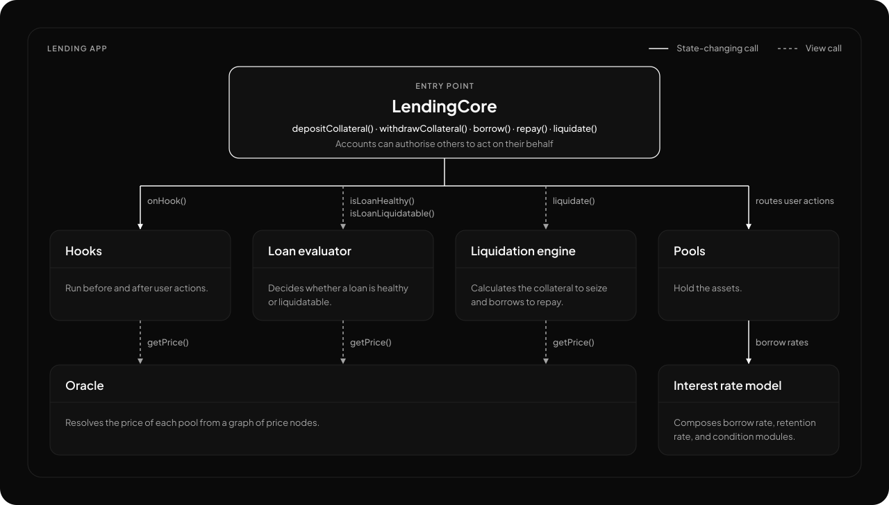
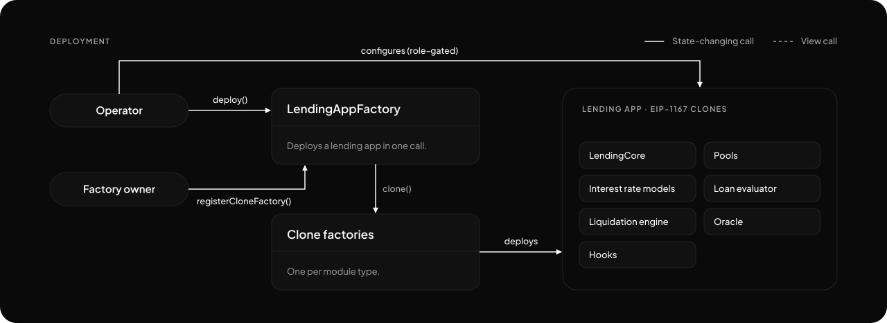

<p align="center">
  <picture>
    <source media="(prefers-color-scheme: dark)" srcset="assets/logo-dark.svg">
    
  </picture>
</p>

<p align="center">Smart contracts powering Onlend: infrastructure to build and launch onchain lending apps.</p>

<p align="center">
  <a href="LICENSE.md"></a>
  <a href="https://onlend.io"></a>
</p>

## Overview

Onlend is infrastructure for building, launching, and scaling onchain lending apps, from a single market to institutional platforms. A lending app is a fully configurable lending environment that its operator owns and controls.

## Architecture

<p align="center">
  
</p>

- **LendingCore** manages the pool listing and routes user actions to the listed pools. It checks loan health after `withdrawCollateral` and `borrow`. Accounts can authorise others to act on their behalf.
- **Pools** hold the assets. `BorrowablePool` and `CollateralisableBorrowablePool` are ERC-4626 vaults whose assets can be borrowed through LendingCore. `CollateralisablePool` holds protected collateral that is not borrowable. Pools offer fee-free ERC-3156 flash loans while enabled.
- **Debt tokens** assign each borrower to one of several interest rate models.
- **Interest rate models** (`ComposedIRM`) compose borrow rate, retention rate, and condition modules.
- **Loan evaluators** decide whether a loan is healthy or liquidatable. `FactorLoanEvaluator` uses collateral and borrow factors; `NoCollateralLoanEvaluator` imposes no collateral requirements.
- **Liquidation engines**: `TargetHealthLiquidationEngine` for partial liquidations, `FullLiquidationEngine` to close the whole loan, `DisabledLiquidationEngine` to disable liquidations.
- **Oracle**: `NodeOracle` maps pools to oracle nodes, which `NodeManager` registers and processes.
- **Hooks** run before and after user actions. Modules enforce pauses, supply, collateral, and debt caps, and whitelists.

### Deployment

<p align="center">
  
</p>

Each lending app module is an EIP-1167 clone of a fixed implementation. See [src/factories/README.md](src/factories/README.md).

## Documentation

Every contract is documented in place with NatSpec. The interfaces are the best starting point:

| Module             | Interface                                                                                                                                                              |
| ------------------ | ---------------------------------------------------------------------------------------------------------------------------------------------------------------------- |
| Lending core       | [ILendingCore.sol](src/lending-core/interfaces/ILendingCore.sol)                                                                                                       |
| Pools              | [IPool.sol](src/pool/interfaces/IPool.sol), [IBorrowable.sol](src/pool/interfaces/IBorrowable.sol), [ICollateralisable.sol](src/pool/interfaces/ICollateralisable.sol) |
| Loan evaluator     | [ILoanEvaluator.sol](src/loan/interfaces/ILoanEvaluator.sol)                                                                                                           |
| Liquidation engine | [ILiquidationEngine.sol](src/liquidation/interfaces/ILiquidationEngine.sol)                                                                                            |
| Oracle             | [IOracle.sol](src/oracle/interfaces/IOracle.sol), [INodeOracle.sol](src/oracle/interfaces/INodeOracle.sol)                                                             |
| Hooks              | [IHookReceiver.sol](src/hooks/interfaces/IHookReceiver.sol)                                                                                                            |
| Factories          | [ILendingAppFactory.sol](src/factories/interfaces/ILendingAppFactory.sol), [factories README](src/factories/README.md)                                                 |

## Repository structure

```
src/
├── lending-core/     LendingCore: entry point for collateral, borrow, repay, and liquidate
├── pool/             Pools, collateral and debt tokens, interest rate models
├── loan/             Loan evaluators
├── liquidation/      Liquidation engines
├── oracle/           Node-based price oracle
├── oracle-consumer/  Base contract for modules that read prices
├── hooks/            Hook dispatch and hook modules (pause, caps, whitelist)
├── authorisation/    Delegated authorisation for acting on behalf of an account
├── whitelist/        Shared whitelist logic
├── onlend-managed/   Contracts deployed by Onlend and shared across apps (fees, yield adapters)
├── factories/        Clone factories and LendingAppFactory
├── interfaces/       Shared interfaces
└── lib/              Shared libraries
test/                 Unit, fuzz, and invariant tests
```

## Getting started

Requires [Foundry](https://book.getfoundry.sh/getting-started/installation).

```bash
git clone --recurse-submodules https://github.com/Onlend/onlend-contracts
cd onlend-contracts
forge build
forge test
```

Tests are split by type, so each can be run on its own:

```bash
forge test --match-path "test/**/*.unit.t.sol"        # unit
forge test --match-path "test/**/*.fuzz.t.sol"        # fuzz
forge test --match-path "test/**/*.invariants.t.sol"  # invariants
```

## License

The primary license is the Business Source License 1.1, see [LICENSE.md](LICENSE.md).

- Files in [src/oracle](src/oracle) are licensed under MIT, see [src/oracle/LICENSE.md](src/oracle/LICENSE.md).
- [src/lib/ExpLib.sol](src/lib/ExpLib.sol) is adapted from Morpho and licensed under MIT.
